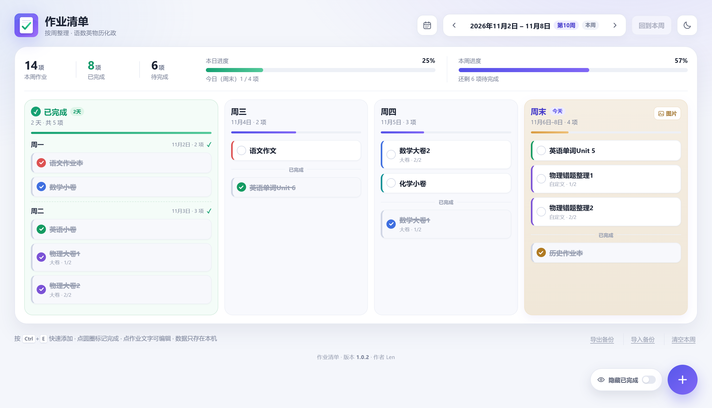
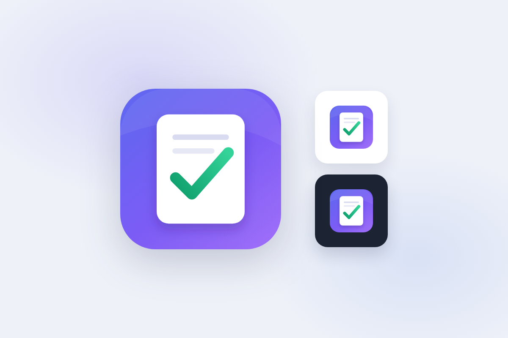
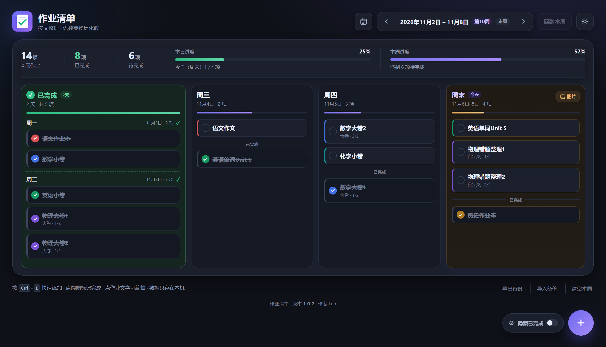
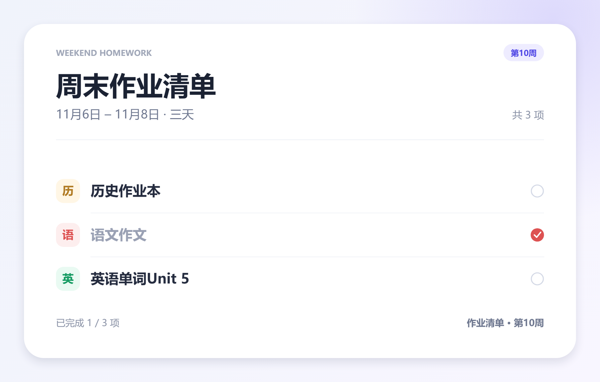

# 作业清单

**双击就能用的按周作业看板** · 纯 HTML/CSS/JavaScript · 离线运行 · 数据只留在本机

一个按周查看、离线可用的作业清单小软件。不用安装、不用注册，双击 `index.html` 就能打开。

它管两套作业：**自己的**存在这台设备上，只有你自己看得见；**班级的**由课代表输密码录入，放在服务器上，全班打开同一个网址看到的是同一份。

周一至周四各占一列，周五到周日合成一个「周末」列。添加作业只要三步——科目、类型、哪天。一份作业可以拆成 2 项、3 项甚至更多，勾选按「项」算，所以一张大卷只做完一半时，进度条也只会走一半。全部做完的那几天会自动并成一个绿色的「已完成」列，固定排在最左边。

右上角还有一个写着每天进度的月历：全做完的那天整格变绿，一整周都做完就整行铺绿，并在背景上印一句「真棒」「厉害」。此外还有夜间模式、备份导出与导入、把周末作业导成一张图发群里，以及累计完成 10 项时的一场烟花。

当前版本 **1.1.7** · 作者 Len



## 功能一览

- **按周查看** —— 周一至周四分列，周五、周六、周日合成一个「周末」列；可切换上一周、下一周、回到本周。
- **一天从早上 6 点算起** —— 0:00–5:59 仍算前一天，熬夜写作业不会一过零点就跳到新的一天。
- **按「项」记进度** —— 一份作业可拆 2～20 项，勾掉一项走一格，大卷做一半就是一半。
- **完成即变绿** —— 某天全部做完，整块方框变绿；两天及以上做完会自动并成「已完成」列，排在最左边。
- **月历** —— 每个日期下面显示当天的「已完成/总数」，整周完成整行铺绿并印一句鼓励；日历跟着视图走，个人看个人的、班级看班级的。
- **班级视图** —— 打开默认就是它，一天一张单子，只显示班级作业，适合投屏；点按钮切到个人。
- **班级共享** —— 课代表点页脚 Len 输密码，就能发布班级作业，全班同一份；每人勾自己的，进度互不影响。
- **通知** —— 解锁后可编辑一条通知，只显示在班级视图、版本号上方，全班所有人都能看到。
- **意见反馈** —— 左下角「意见反馈」随时能写，正文必填、最多 500 字；管理员解锁后可在同一个窗口按时间查看全部反馈。只有部署在 GitHub Pages 上的版本，点它才改为打开 GitHub Issues。
- **账号登录** —— 自己注册用户名，个人作业跟着账号走，换设备也能看到；登录后可查看「我的记录」、浏览反馈并回复。
- **可编辑** —— 点作业标题就能改科目、日期、项数，已经打过的勾不会丢。
- **夜间模式** —— 白天 / 黑夜一键切换，跟随系统时不闪白。
- **备份** —— 一键导出 JSON，导入按 id 合并，不会覆盖现有记录。
- **周末出图** —— 把周末三天的作业生成一张 PNG，直接发群里。
- **离线可用** —— 单个 HTML 文件、零依赖，可「安装」到桌面当作独立小软件（PWA）。

## 打开方式

- 双击 `index.html`，用浏览器打开即可（个人作业可用，班级作业只在本机）。
- 或者双击 `打开作业清单.bat`，会自动用默认浏览器打开。
- 想让全班共用一份班级作业，请按上面的「部署到服务器」启动 `server.js`，然后用网址访问。
- 在软件里按 **Ctrl + E** 可以快速打开添加作业窗口。

推荐使用 Chrome、Edge 或 Firefox。

## 图标

- `icon.svg`：主图标，页面图标和左上角 Logo 使用它。
- `icon-512.png` / `icon-192.png`：高清 PNG，适合应用列表或后续做 PWA。
- `favicon-32.png`：浏览器标签页备用图标。
- `apple-touch-icon.png`：iPhone / iPad 添加到主屏幕时使用。
- `icon-square.svg`：无圆角方形版本，适合需要系统自行裁切图标的场景。



## 主界面

- 整周包在一个大框里，周一至周四各自是小框；周末是一个包含三天的小框。
- 大框顶部同时显示**本日进度**和**本周进度**，每个有作业的星期也有当天进度。
- 只显示**有作业**的星期；没有作业的星期不会显示。
- 如果整周一项作业都没有，大框里会显示「本周没布置作业」，进度按 **100%** 显示。
- 右上角显示当前日期范围和**第几周**，可以切换上一周、下一周或回到本周。
- 添加作业只通过右下角的圆形 **+** 按钮或 **Ctrl + E**，主界面不再有单独的添加作业框。
- 点击作业前的圆圈可以标记完成。
- **某一天的作业全部做完，这个星期的整块方框就会变绿**（边框、底色一起变），不用等两天。已经合并进「已完成」列的多天同样是绿色。
- 右下角加号旁边有「隐藏已完成」开关，默认开启。
- 手机上顶栏分两行：第一行是 `‹ 日期区间 第几周 ›`，第二行是日历、班级、回到本周、主题四个按钮，不会被挤出屏幕。
- 右上角有白天 / 黑夜切换按钮，点一下立即换肤。

## 班级视图

日历图标右边有一个写着「**班级**」的方块按钮，点一下进入班级视图（按钮变紫色、文字变成「**个人**」），再点一下切回个人视图。

- 这里显示的是**班级作业**——课代表发布的那份，全班同学看到的完全一样；自己的作业还在个人视图里，两边互不混。
- 一次只看**一天**，卡片占满整行，适合投到教室屏幕上，一屏说清今天要做什么。
- 顶部日期从「周范围 + 第几周」变成**具体日期 + 星期几**，`‹` `›` 变成前后**一天**，按钮变成「回到今天」。
- 周五、周六、周日共用「周末」这张单子（三天合在一起），和周视图口径一致。
- 顶部统计跟着变成**当天**的项数与完成率，「本日进度」改为「当天进度」，本周进度条自动收起。
- 点日历里的某一天，会直接跳到那一天（而不是那一周）。
- **每个人的勾选只存在自己这台设备上**，你勾掉不会影响别人，换台电脑进度也不会跟着走。
- **第一次打开默认就是班级视图**（没连后端时会显示「未发布作业」）；点按钮切到个人后，会记住你的选择，刷新和下次打开都停在上次看的地方。
- 某天没有班级作业时，卡片里只写「未发布作业」；解锁后会多一行「点右下角的 + 发布这一天的班级作业」。

没解锁时这里只能看和勾：右下角加号隐藏、`Ctrl + E` 不响应、点作业文字不弹编辑、删除按钮不显示、「清空本周」也一并隐藏。

## 发布班级作业

1. 点页脚的 **Len**，弹出「班级管理」窗口。
2. 输入班级密码。仓库里**没有内置密码**，部署时自己设一个，两种方式任选：
   - 虚拟主机：在 `data/secret.php` 里写 `<?php return '你的密码';`
   - VPS：启动时用环境变量 `CLASS_PASSWORD`
   没设置密码时后台会拒绝登录并提示，不会用默认密码放人进来。
3. 解锁后右下角出现 **+**，点它选科目、类型、日期，发布的就是全班共享的班级作业；默认选中你正在看的那一天。
4. 解锁后每张班级作业右侧出现 **×**，可以删除。
5. 再点一次 Len 就退出班级管理。

密码在服务器端校验，前端拿不到明文。没连服务器（双击打开或纯静态托管）时，密码只在本机生效，班级作业也只存在本机，不会共享。

## 通知

在**班级视图**里解锁班级管理后，页脚版本号的右边会出现「**编辑通知**」按钮：

1. 点它，弹出一个输入框，最多 200 字，支持换行。
2. 保存后，通知显示在**班级视图的版本号上方**，宽度随窗口自适应，手机上自动换行；切到个人视图时通知自动隐藏。
3. 内容存服务器（`data/notice.json`），打开网址的所有人都看得到。
4. 想撤掉就再点一次「编辑通知」，清空保存即可。

没解锁的人只能看，看不到「编辑通知」按钮；没有通知时整条通知条不显示。

## 意见反馈

左下角固定着一个「**意见反馈**」按钮，谁都能点，不需要密码。

1. 名字可以留空，留空在后台显示为「匿名」；正文必填，最多 500 字，输入框下面有实时字数。
2. 提交后存到服务器的 `data/feedback.json`，只保留最近 300 条；登录状态下提交的会记下归属账号。
3. **谁能看到哪些反馈**：
   - 管理员（点页脚 Len 输密码）：看到全班所有人的反馈，标题显示「全部反馈」。
   - 已登录的普通账号：只看到自己提交过的反馈，标题显示「我的反馈」；别人的反馈在接口层就被过滤掉，不是前端藏起来。
   - 没登录：写反馈时看不到列表，提交后由管理员查看。
4. 每条反馈下面可以「**回复**」：
   - 管理员可以回复任意一条。
   - 普通账号只能回复自己提交的那条（补充说明用），回复别人的会被服务器拒绝。
   - 回复按时间排在反馈正文下面，显示回复人和时间；管理员给别人反馈的回复，原提交者下次打开也能看到。
5. 反馈入口按访问方式区分：**部署在 GitHub Pages 上**（域名以 `.github.io` 结尾）时，点「意见反馈」直接打开 [GitHub Issues](https://github.com/Len-Stitch/homework-board/issues/new)，因为纯静态托管没有地方长期保存反馈；其他情况——直接双击 HTML、PHP / Node 后端、其它静态托管——都还是弹出上面这个表单，提交后存到服务器或本机。
6. 如果本机还留着管理员身份、但服务器上的密码已经改过，列表会降级为「我的反馈」，并提示「管理员密码已失效，请重新点页脚 Len 登录」。

## 账号

页脚版本号右边有一个「**登录**」按钮，点开可以登录或注册（用户名 2–16 个字，中文、字母、数字、下划线；密码至少 4 位）。

登录后：

- 个人作业会存到服务器上的账号里，换一台设备用同一个账号登录，记录还在；同一个账号可以在多台设备上同时登录，互不挤下线（每个账号最多保留 20 个设备的登录态）。
- 点页脚的「@用户名」打开「**我的记录**」：条数、总项数、已完成、完成率，以及最近 8 条作业。
- 点左下角「意见反馈」会直接进入「我的反馈」列表，只能看到自己提交过的反馈，并可以给自己的反馈补充回复。
- 页脚会多出一个「退出登录」，退出后回到本机数据（本机原有记录不会被删除）。

第一次在某个设备登录时，如果账号里还没有数据、本机已经有作业，会自动把本机记录上传到账号；如果账号里已经有数据，则以账号数据为准，同时在本机留一份 `homework-pre-login-backup` 备份，防止选错账号丢数据。

注册和登录都需要连服务器（`api/index.php` 或 `server.js`），直接双击 HTML 只能用本机数据。

## 部署到服务器

班级作业要「所有人看到同一份」，就需要一个后端。项目带了**两套**，用哪套取决于你的主机：

| 主机类型 | 用哪个 | 说明 |
|---|---|---|
| **虚拟主机 / 共享主机**（宝塔、万网、景安…） | `api/index.php` | 只能放文件、跑 PHP，不能常驻进程 |
| **VPS / 云服务器 / 能跑 Node 的容器** | `server.js` | 零依赖 Node 服务，自带静态托管 |

前端会自动探测，**你不用改代码**：先试 `api/?action=ping`，通了就走 PHP；不通再试 Node 接口；都没有就退回本机存储。

### 方式一：虚拟主机（PHP）

1. 把整个项目文件传到网站根目录（`wwwroot` / `public_html`），包括 `api/` 文件夹。
2. 设置管理员密码。在网站根目录的 `data/` 文件夹里新建 `secret.php`，只写一行：

   ```php
   <?php return '你的密码';
   ```

   这个文件不会被 Git 跟踪，服务器上的 `data/.htaccess` 也会拒绝浏览器直接访问它。代码里只留了占位符 `CHANGE_ME`，没有真实密码。
3. 确认 `data/` 目录可写（755 或 777）。没有这个目录也没关系，第一次发布作业会自动创建。
4. 浏览器打开 `你的域名/api/?action=ping`，返回下面这样就成了：

   ```json
   {"ok":true,"backend":"php","version":"8.1.34","writable":true}
   ```

   `writable` 是 `false` 的话，说明 `data/` 目录没写权限，去主机面板改一下目录权限。

班级作业会存在 `data/class-homework.json`，备份这个文件就等于备份班级作业。

### 方式二：VPS（Node）

```bash
# 密码必须通过环境变量传入，代码里没有默认密码
CLASS_PASSWORD=你的密码 node server.js
PORT=8080 CLASS_PASSWORD=你的密码 node server.js
```

Windows 上直接双击 `启动班级服务.bat` 也行。第一次运行会提示输入密码；也可以在同目录建一个 `config.local.bat`，写上 `set CLASS_PASSWORD=你的密码`，这个文件已被 `.gitignore` 排除，不会进仓库。启动后本机和局域网地址会打印在控制台，同学用 `http://你的IP:3000` 就能打开。页面文件、图标、`manifest.json` 也由这个服务一起托管，不需要额外的 Nginx。

### 上线前必做

- **设置一个别人猜不到的密码**。仓库里只有占位符 `CHANGE_ME`，没设置密码时后台相关接口一律返回 503，不会放人进去。
- **配 HTTPS**。「安装到桌面」和离线缓存只在 `https://` 下生效；虚拟主机一般在面板里点一下就能申请免费证书。

### 需要上传哪些文件

```
index.html          ← 应用本体
api/index.php       ← PHP 后端（虚拟主机用）
server.js           ← Node 后端（VPS 用，虚拟主机可不传）
sw.js               ← 离线缓存
manifest.json       ← 安装到桌面
icon.svg / icon-square.svg
favicon-32.png / icon-192.png / icon-512.png / apple-touch-icon.png
README.md           ← 可选
```

另外要在服务器的 `data/` 里新建 `secret.php` 放管理员密码（见上面的「方式一」）。

`data/` 目录不用提前建，程序会自己创建。部署时不用传 `index.html.bak-*`、`preview*.png`、`.bat` 这些本机用的文件——仓库里保留它们，是为了让下载的人双击就能跑。

## 编辑和移动作业

- 点作业标题（文字部分）会打开「编辑作业」窗口，可以改科目、类型、名称、拆分项数。
- 想在周内挪一天：在编辑窗口里直接选另一天，点「保存修改」即可。
- 保存时会保留已经勾掉的项（改项数时按新项数保留前面的勾选状态）。
- 每项作业右侧的 **×** 是删除整份作业，删完 4 秒内可以点提示条上的「撤销」。

## 黑夜模式

- 右上角圆形按钮切换白天 / 黑夜，状态会记住。
- 第一次打开时跟随系统的深浅色设置；手动切过一次之后以手动选择为准。
- 切换后浏览器地址栏（手机端）的颜色也会跟着变。

## 本日进度和本周进度

- **本日进度**：只统计今天所在的那个显示栏；今天没有作业时显示 100%，并提示「今日没布置作业」。
- **本周进度**：统计周一到周末的全部作业。
- 当查看的不是本周时，本日进度显示「—」，并提示今天不在本周；本周进度仍然正常显示。

## 周末包含三天

- 周末不再拆分，统一显示为一个「周末」列，包含三天的作业。
- 周末日期范围显示为三天的起止日期，例如「11月6日–8日」；列里只显示「周末」，不显示单独的日期小段。
- 周末的「图片」按钮会导出这三天的全部作业。
- 添加作业的日期选择只有「周一、周二、周三、周四、周末」五项；以前落在周末三天的作业会自动归入周末列。
- 周末列底色比作业卡片**深一档**（白天是暖米色、黑夜是暖深棕），作业一多也能一眼分开每一条；深色模式下卡片还带一圈暖色描边，已完成的暗色卡片同样看得清边界。周末全部做完变成绿色时，自动换回普通描边。

## 已完成合并

- 周一到周四里，如果有 **2 天及以上**的作业全部完成，会自动合并成一个「已完成」列。
- **合并列固定排在最左边**，未完成的天依次排在它右边；周末固定在最后一列，不参与这个合并。
- 合并列里按天列出「周一、周三、周四」以及各天的日期和项数，并显示整体 100% 完成。
- 只有 1 天全部完成时不合并，保持原来的位置。
- 打开「隐藏已完成」时，合并列只显示每天的完成概况；关闭后，已完成作业会显示在对应日期的下方。

## 隐藏已完成

- 开关在右下角加号旁边，打开后已完成的作业会从当天清单中隐藏。
- 当天还有未完成作业时，清单底部会显示「已完成 N 项，已隐藏」。
- 周一到周四中，单独一个工作日全部完成时会显示「已完成全部 N 项」；2 个及以上全部完成时进入「已完成」合并列。
- 关闭开关后，未完成的作业在上，已完成的作业显示在下方，中间有「已完成」分隔线；合并列和周末列里也会展开到对应日期下方。
- 开关状态会记住，刷新或下次打开后保持。

## 完成烟花

- 累计完成 **10、20、30…** 项作业时，会全屏放烟花，并随机显示一句鼓励的话。
- 里程碑按累计完成数计算，不会因为取消勾选再重新勾选而重复触发。
- 点击「继续加油」、点击烟花空白处或按 Esc 可以关闭，约 8.5 秒后也会自动关闭。

## 作业类型

添加作业时：先选科目，再选作业类型，最后选择安排到哪一天。

**所有科目**

- 小卷：显示 1 项。
- 大卷：自动拆成 2 项，例如「语文大卷1」「语文大卷2」。
- 超大卷：自动拆成 3 项，例如「语文超大卷1」「语文超大卷2」「语文超大卷3」。
- 作业本：显示 1 项。
- 自定义：自己输入作业名称，并设置拆分项数（1–20 项）。拆分为 1 项时显示为「科目 + 自定义名称」，例如「数学错题整理」；拆分为多项时才加序号，例如「数学错题整理1、2、3」。

**只在语文、英语中出现**

- 作文：例如「语文作文」「英语作文」。
- 背：可以填写背诵内容，例如填写「《赤壁赋》」后显示为「语文背《赤壁赋》」。

**只在英语中出现**

- 短语：可以填写范围，例如「英语短语Unit 5」。
- 单词：可以填写范围，例如「英语单词Unit 5」。

**只在语文中出现**

- 文言文选修：显示为「语文文言文选修」。

## 周末作业图片

「周末」列的右上角有一个「图片」按钮，点击后会把本周周末三天的全部作业生成一张 PNG 图片：

- 自动包含科目、作业名称、拆分项、完成状态和本周进度。
- 在弹窗里可以预览，点击「下载图片」保存到电脑或手机。
- 可以把图片发到班级群，也可以打印出来。

## 关于「第几周」

周数按学期自动计算：

- 9 月 1 日所在的周作为秋季学期第 1 周；
- 2 月 1 日所在的周作为春季学期第 1 周；
- **春季学期到 6 月底结束**，7 月和 8 月这两周起的日期显示为「学期前」，不参与编号。

当前这一周（2026 年 11 月 2 日–11 月 8 日）显示为**第 10 周**。

## 数据说明

分成两类，别搞混：

| | 存在哪 | 谁能看到 | 清缓存会丢吗 |
|---|---|---|---|
| **个人作业** | 这台设备的浏览器 | 只有你 | 会丢，记得导出备份 |
| **班级作业** | 服务器的 `data/class-homework.json` | 全班所有人 | 不会，服务器上还在 |
| **勾选进度** | 这台设备的浏览器 | 只有你 | 会丢（作业本身还在） |
| **通知** | 服务器的 `data/notice.json` | 全班所有人 | 不会 |
| **意见反馈** | 服务器的 `data/feedback.json` | 本人只看自己的，管理员看全部 | 不会（仅 GitHub Pages 版点按钮去 Issues） |
| **账号** | 服务器的 `data/users.json` | 用户名公开，密码加密存储 | 不会 |
| **登录态** | 服务器的 `data/sessions.json` | 只有服务器自己用 | 不会，删掉等于所有人要重新登录 |

- 个人作业不会上传，换浏览器、换电脑就是空的，可以用「导出备份 / 导入备份」搬。
- 班级作业由课代表发布，同学只读不写，所以谁勾了什么都不影响别人。
- 班级作业单独备份：把服务器的 `data/class-homework.json` 下载下来就行。
- `data/users.json` 和 `data/sessions.json` 是分开的：前者存账号和个人作业，后者存登录 token。这样一台设备保存作业时，不会把另一台设备刚登录的 token 覆盖掉。

## 日历

周数左边的日历图标可以打开月历：

- 一行七天，**周一在最左、周日在最右**。
- 每个日期下面显示当天的 **已完成数 / 总数**，例如 `3/5`。
- **当天全部完成**：格子底色变成浅绿，日期数字和统计一起变成深绿色；没做完就是普通底色 + 正文色。
- **整周全部完成**：这一行（周一到周日）的**整块背景变成浅绿色**，不是只描一条线。判定要求严格——周一、周二、周三、周四**每天都有作业**，周末（三天合并成的一格）也有作业，并且全部做完，才会变绿。中间空一天就不算整周完成。
- 整周完成时，周一～周四这块绿底上还会印一句**鼓励的短词**（「真棒」「厉害」「满分」「完美」「优秀」「漂亮」等 12 条，按周轮换，相邻的周不会重复），是印在背景上的水印，不额外占一行。
- **周五、周六、周日三天的方框合并成一个**：格子里并排显示三个日期数字，下面只显示一份合并统计 `已完成/总数 百分比`，例如 `1/5 20%`。平时三格合成一块浅琥珀底色，整周完成时随整行一起变绿。
- 合并的周末格里，背景有一个很大的 **学期周数数字**（如 `10`，就是第 10 周），把格子填满，一眼能看出这一周是学期第几周；假期（7、8 月）没有周数，背景留空。
- 点任意日期（含合并的周末格）会直接跳到那一周并关闭日历。
- 「今天」按钮回到本月并跳到本周；`‹` `›` 切换月份；点空白处或按 Esc 关闭。
- 当天是实心圆角高亮，正在查看的那一周有一圈淡紫描边。

## 备份与恢复

因为数据只在浏览器里，换电脑、换浏览器或者清缓存都会丢，所以提供了手动备份：

- 页面底部点 **导出备份**，会下载一个 `作业清单备份_日期.json`，里面有全部作业。
- 想恢复时点 **导入备份** 选中那个文件即可。
- 导入是「按 id 合并」：备份里已有的作业会更新，没有的会新增，**不会删除你现有的数据**。
- 导入结果会提示「新增 N 条，更新 N 条，跳过 N 条」。
- 建议每周导出一次，存到网盘或发给自己。

## 安装到桌面（可选）

文件夹里带了 `manifest.json` 和 `sw.js`：

- 用 `file://` 双击打开时，这两个文件不生效，正常使用即可（功能完全一样）。
- 如果把文件夹放到任意 http/https 地址（本机起个服务、或用静态托管），用 Chrome / Edge 打开后可以在地址栏右侧点「安装」，变成独立窗口的应用，并且完全离线可用。
- iPhone / iPad 用 Safari 打开后「添加到主屏幕」也可以。

## 界面预览

主界面（白天，显示已完成作业）：


夜间模式：



完成十项倍数时的烟花：


生成的周末作业图片：


